  

  
  
  
  
  

## The short version

FAR Action Radar runs three market engines. Each publishes one call a week: **NORTH** on gold, **AXIS** on bitcoin, **RIG** on oil. Every call is written to Base when it is published, and its result is added when the week closes, so the track record can be checked by anyone, not only read on our site.

Weekly gold, bitcoin and oil calls recorded on Base, NFT collectibles and onchain tools. Research data, not investment advice.

  

## What we build

📡 **Signals.** NORTH, AXIS and RIG weekly calls, with every week on the record: [verify on Base](https://www.faractionradar.com/verify).

🃏 **FAR Fortune.** A card collection on Base, with a Forge and Bloodlines: [faractionradar.com/fortune](https://www.faractionradar.com/fortune).

🔮 **Prophecy.** Make your own weekly call with a card: [faractionradar.com/prophecy](https://www.faractionradar.com/prophecy).

  

## Faro ($FARO)

The access token of FAR Action Radar, on Base.

Lock FARO to unlock FAR Pro for as long as the lock runs.

| | |
|---|---|
| Network | Base (chain ID 8453) |
| Contract | [`0x98233f8449A07c98157CB68cf394a052a99a67F0`](https://basescan.org/token/0x98233f8449A07c98157CB68cf394a052a99a67F0) |
| Symbol / decimals | FARO / 18 |
| Supply | 1,000,000,000 fixed. No owner, mint, tax, blacklist or pause |
| Token page | https://www.faractionradar.com/token |
| Logo | https://www.faractionradar.com/faro/faro-logo-256.png |

**Distribution:** 70% in the Uniswap v3 FARO/WETH pool (launch LP locked until 2028-11-04), 20% in a 2-of-3 Safe, 10% team vesting (12 months, 3-month cliff). No presale, private sale or investor allocation.

## Official contracts (Base)

Only these addresses are FAR's. Anything else using the name is not ours.

| | Address |
|---|---|
| Treasury Safe (2-of-3) | [`0x0C8750850291dDe2bDC4f0Ae042d393a9Cf7aA33`](https://basescan.org/address/0x0C8750850291dDe2bDC4f0Ae042d393a9Cf7aA33) |
| Uniswap v3 FARO/WETH pool | [`0x0fFd233bAb03e4aA7eE21C2002bDf0f81b6aA8Ee`](https://basescan.org/address/0x0fFd233bAb03e4aA7eE21C2002bDf0f81b6aA8Ee) |
| LP lock (until 2028-11-04) | [`0x8EA12076963305d8f6A1c9Ee58FeDC54a3fA1785`](https://basescan.org/address/0x8EA12076963305d8f6A1c9Ee58FeDC54a3fA1785) |
| Team vesting | [`0x4c2225fefD23305D84C6ef70f9fc500310f6bF84`](https://basescan.org/address/0x4c2225fefD23305D84C6ef70f9fc500310f6bF84) |
| FarOutcomes (weekly calls on Base) | [`0x1E7d9058eD2f86FE7399567d7Ae9d6E49F9Ee870`](https://basescan.org/address/0x1E7d9058eD2f86FE7399567d7Ae9d6E49F9Ee870) |
| FAR Weekly Calls | [`0x990EB3108AAE8ce0f4E4C4402b9d36685B1DA04B`](https://basescan.org/address/0x990EB3108AAE8ce0f4E4C4402b9d36685B1DA04B) |
| FAR Fortune | [`0x66c3955FC1efFf4840Ad7b13BD6982E9709C5018`](https://basescan.org/address/0x66c3955FC1efFf4840Ad7b13BD6982E9709C5018) |
| Forge | [`0x1d9DA996cA82Df191cd85A811a52bBD93636AF0C`](https://basescan.org/address/0x1d9DA996cA82Df191cd85A811a52bBD93636AF0C) |
| Bloodlines | [`0xB69ff53fC298bd090C23637915b4Fae0a8Ce01A3`](https://basescan.org/address/0xB69ff53fC298bd090C23637915b4Fae0a8Ce01A3) |
| Call Book | [`0x34Eb63ecD53371A8aed9A53daEDb706971Bb4F80`](https://basescan.org/address/0x34Eb63ecD53371A8aed9A53daEDb706971Bb4F80) |
| FAR NFT Market | [`0x0281CfeA8ab09EB96cCa2Ed42286a59Be1aF93b2`](https://basescan.org/address/0x0281CfeA8ab09EB96cCa2Ed42286a59Be1aF93b2) |
| Lock FARO for Pro | [`0x8ef6B34D655fa5ba537b751f0df119386C9b9E44`](https://basescan.org/address/0x8ef6B34D655fa5ba537b751f0df119386C9b9E44) |
| Pay with FARO (Pro checkout) | [`0x3498c074FC6f762806E37F9975f6A30BB94b62Ab`](https://basescan.org/address/0x3498c074FC6f762806E37F9975f6A30BB94b62Ab) |
| FAR Pro Access (NFT) | [`0x1d7EE6FaE83867A572b041Fe7019a93127094D15`](https://basescan.org/address/0x1d7EE6FaE83867A572b041Fe7019a93127094D15) |
| FAR Radar Pass (NFT) | [`0x65ba24ef735a488ad6664fC97552Bbe35b48082f`](https://basescan.org/address/0x65ba24ef735a488ad6664fC97552Bbe35b48082f) |

Every current contract, plus the retired ones, with copy buttons: https://www.faractionradar.com/contracts

## How we work

> Every call stays on the record, wins and losses.
>
> Rules are published before they apply.

Built on Base · <a href="https://www.faractionradar.com">faractionradar.com</a> · <a href="https://x.com/FarActionRadar">X</a> · <a href="https://t.me/faractionradar">Telegram</a>

